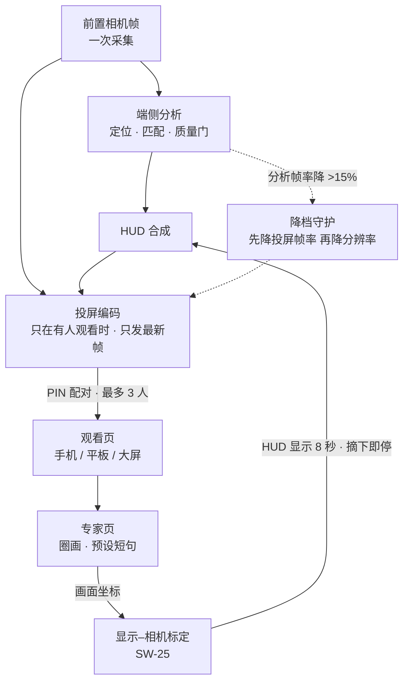
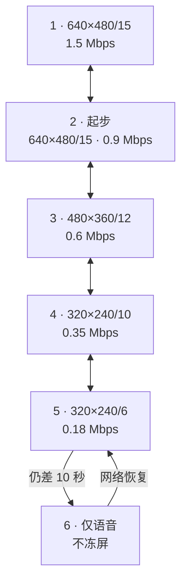

# 原型经验：投屏、远程视频与端侧视觉算法

**v0.1 · 2026-11-09 · 对应 [技术路线](technical-roadmap.md) v0.1.4、[设计开发要求](design-requirements.md) v0.3.3**

本页把我们在**现有单目 AR 眼镜上做的应用原型**里验证过的核心技术，整理成本方案可以直接继承的做法。

原型和本方案的关系：
- 原型是一副市售 AR 眼镜（Android、单目显示、前置相机、IMU、Wi-Fi）上的工作辅助应用：实时画面 → 定位 → 引导 → 自动拍摄 → 远程专家协助。
- 原型的业务场景、客户数据、内部服务器地址和账号都**不进入公开仓库**；本页只写技术、参数和实测数字。
- 标注沿用方案的四类：
  - 【原型实测】在原型眼镜或原型服务上测过；
  - 【原型单测】只在单元测试、模拟器或合成数据上验证，**不能当真机结论**；
  - 【项目判断】本项目的取舍；
  - 【设计目标】还没测过。

---

## 0 一页看懂

| 原型里的技术 | 解决什么 | 本方案用在哪 | 新增要求 |
| --- | --- | --- | --- |
| 第一视角投屏（眼镜 → 手机 / 平板） | 让旁人、专家实时看到佩戴者所见 | 方案 §3.7「让对方看到我所见」、§4.5 投屏链路的反方向 | CALL-21、SEC-09 |
| 远程专家标注回传 | 专家在画面上圈画、发短句，眼镜 HUD 显示 | 通话中的协作层；投屏叠加层 | CALL-22 |
| 远程视频通话：路线收敛 + 六档自适应 | 弱网不卡死、不冻屏，最差保声音 | CALL-08 V2 眼镜独立通话、CALL-10 弱网降档 | CALL-19、CALL-20 |
| 相机–IMU 时间对齐 + 头姿缓冲 | 求出「这一帧拍下时」到「现在」的头部转动 | 重投影（显示处理器）、空间锚定 | SW-24 |
| 显示–相机标定（9 参数） | 消除相机与人眼的视差，让框和圈落在真实物体上 | 叠加层、标注回传、看板态定位 | SW-25 |
| 质量门 + 静止门 + 特征匹配 | 糊图、遮挡、晃动时不拍、不上传 | 一次采集多处用（SW-22）、拍照与识别 | SW-26 |
| 来源标注 + 只出候选 | 用户分得清实时、模拟和预录；AI 不替人判定 | 脑的输出、看板卡片 | SW-27 |
| Agent 协议：只说、只显示、不自动重试 | 大模型接入眼镜但不能越权操作 | 脑 → 派手的边界（方案 §1.1） | 并入 SW-27 |

---

## 1 投屏：第一视角推给旁人（眼镜 → 观看端）

方案 §4.5 写的是**主机 → 眼镜**的投屏。原型做的是反方向：**眼镜把自己看到的画面（含 HUD）推给手机、平板或大屏**，用于演示、现场协作和远程专家。两条链路在本方案里同时存在。

### 1.1 链路



### 1.2 关键做法

| 做法 | 原型参数 | 为什么 |
| --- | --- | --- |
| 默认关闭，佩戴者单击开启 | 首页「无线投屏」开关 | 摄像头画面外流必须佩戴者主动打开 |
| 配对：扫码或输入地址 + 角落 PIN | 观看端输入佩戴者告知的 PIN，换取会话 cookie | 不需要账号；只有在场的人能看 |
| 限流 | 最多 3 个观看者；PIN 每分钟 5 次；30 分钟或退出自动关闭 | 防爆破、防遗忘 |
| 无人观看不编码 | 无观看者时不绘制、不编码；只保留最多一个快照，关闭会话即释放 | 省电、省内存 |
| 只发最新帧 | latest / busy 丢帧：编码或发送忙时丢旧帧，**不积压** | 网络抖动后立即回到实时，不出现「越看越慢」 |
| 分析优先的降档守护 | 先采 3 个无编码样本做基线；分析帧率连续 3 秒下降超过 15% → 投屏 10 → 5 fps；再过 5 秒仍低 3 秒 → 降到 240×320；**分析档位不降** | 投屏是附加功能，不能拖慢端侧识别 |
| 观看端时钟校准 | 观看页估算服务器时钟偏移，再显示帧龄 | 跨设备显示延迟时不被时钟差误导 |
| 可观测 | `cast_fps`、`cast_target_fps`、`cast_viewers`、`cast_drop`、编码 CPU、分析帧率、基线 | 真机验收直接读日志 |

【原型单测】合成帧在开发机上：软件绘制 + JPEG Q60 平均 5.04 ms/帧，编码线程 CPU 3.62 ms/帧；10 fps 约 1.23 Mbps/人。**这不是眼镜 CPU 实测**，真实相机纹理会改变帧大小。

【原型实测】投屏相关用例 26 项 × 4 个构建变体通过；PIN / 会话 / 限流、观看上限、私网地址选择、丢帧、>15% 降档、圈画坐标都有用例。真机「玻璃到玻璃」延迟尚未测（验收方法见 1.4）。

### 1.3 远程专家标注回传

- 专家在浏览器专家页上**圈画**并从预设短句里**选一句**发送；眼镜 HUD 显示圈和句子 **8 秒**，同时播放预置语音片段。
- 佩戴者单击可暂停 / 恢复标注；**离开、摘下、折叠时禁用**，恢复后不重播旧圈画和旧声音。
- 圈画坐标在观看画面坐标系里下发，眼镜按 SW-25 的显示–相机标定换算到 HUD；没有标定时只显示在画面坐标附近，并标注「位置为近似」。
- 【项目判断】本方案把它做成**投屏图层的一个叠加层**：和方案 §4.5 的「DP 画面层 + MCU 气泡层」同一套叠加机制，专家圈画是第三类叠加内容（HW-DP-07 的扩展）。

### 1.4 真机验收方法（原型已写好，本方案沿用）

1. 秒表与画面同框，测玻璃到玻璃延迟各 30 次，取 p50 / p95；投屏与有线镜像分开测。
2. 拥塞、遮挡、断连：不积压旧帧，记录恢复时间；1 人与 3 人观看分别测。
3. 熄屏、摘下、折叠、切后台各 5 次：不播旧圈画和旧声音，恢复后可重连，退出后端口关闭。
4. 同一场景先 60 秒无投屏做基线，再 1 人、3 人各 60 秒，比较分析帧率，核对两级降档。
5. 30 分钟电量、温度、崩溃记录，与无投屏对照；核对 30 分钟自动关闭。
6. 错误 PIN、第 4 个观看者被拒绝。

### 1.5 安全边界

- 局域网投屏是明文 HTTP，**只允许在可信、隔离的网络里用**；禁止公网转发。
- 本方案的正式版本：机身有蜂窝，佩戴者可能在公共网络里，所以**正式版对外投屏走第 2 节的加密通话链路**，局域网明文模式只留给开发和演示（SEC-09）。

---

## 2 远程视频通话

### 2.1 路线收敛：四条变一条半

原型先后做过四条通话路线，最后收敛：

| 路线 | 做法 | 结论 |
| --- | --- | --- |
| ① 原生 WebRTC + 自建信令 + 自建 TURN | 眼镜原生库，媒体走自建中继 | 能用，但要长期维护信令、TURN 和出口带宽；访客必须在内网 |
| ② 第三方会议应用（WebView 打开） | 不依赖自有服务器 | **保留为保底**：零运维；缺点是 WebView 重、要扫码登录 |
| ③ 浏览器 P2P | 网页 + 简单信令 | 跨网没有 TURN 就不通，配 TURN 又回到 ① |
| ④ 电脑中转 | USB 接电脑，电脑上用会议软件 | 链路最长、依赖最多，删 |
| **收敛后** | **一条托管实时音视频（RTC）主路线 + 一条会议应用保底** | 眼镜只留一套原生媒体库；通话时不开 WebView；估算净删约 6500 行代码 |

【项目判断】这和本方案 CALL-07～09 的 V1 / V2 / V3 三条路线并不冲突：V2「眼镜独立通话」的媒体层按「一条托管 RTC + 一条会议应用保底」实现；V1、V3 是画面从哪里来，不是媒体栈。

### 2.2 眼镜端媒体参数

| 项 | 原型取值 | 说明 |
| --- | --- | --- |
| 相机 | **自定义采集**：自己的相机管线出帧，再喂给 RTC SDK | 原型眼镜上，SDK 自带采集曾触发相机 HAL 崩溃；自定义采集还能和端侧分析共用一路相机（SW-22 一次采集多处用） |
| 分辨率 / 帧率 | 640×480 / 15 fps 起步 | 原型眼镜上最稳的一档；本方案主 SoC 更强，CALL-10 的 1080p30 仍是目标 |
| 编码 | 硬件 H.264；起步约 0.9 Mbps，下限约 0.2 Mbps | — |
| 场景 | 通话场景（低延迟优先），不是直播场景 | — |
| 订阅 | 眼镜**只订阅一路远端视频**，无论会上多少人 | 解码只占一路，留给 CALL-12 并发 |
| 线程 | UI 线程不碰网络和编解码；RTC 操作在独立线程，UI 线程只画 HUD | 原型「打视频卡死」的根因之一 |
| 未佩戴静音 | 原型固件在未佩戴时把录音置零；HUD 提示「系统静音」 | 上行音频测试必须戴着测 |

### 2.3 六档带宽自适应（BandwidthGovernor）

| 档 | 分辨率 / 帧率 | 码率 |
| --- | --- | --- |
| 1 | 640×480 / 15 | 1.5 Mbps |
| 2（起步） | 640×480 / 15 | 0.9 Mbps |
| 3 | 480×360 / 12 | 0.6 Mbps |
| 4 | 320×240 / 10 | 0.35 Mbps |
| 5 | 320×240 / 6 | 0.18 Mbps |
| 6 | 仅语音 | — |



规则：
- **立即降档**：丢包 ≥ 8%、RTT ≥ 700 ms、CPU 受限，或带宽估计偏低且同时有拥塞迹象。
- **升档要稳**：连续 3 次良好才升；最高档要求带宽估计 ≥ 1.5 Mbps 且 RTT < 300 ms；降档后 20 秒内不升。
- **封顶**：走 TCP 中继时封顶 0.9 Mbps；过热封顶 480×360。
- **最低档仍差 10 秒 → 只保留声音**，而不是冻住画面。
- 每 2 秒读一次统计调整；ICE 断开 3 秒或失败 → ICE restart；信令断开自动重连；失败时 HUD 写明原因，不停在「连接中」。

【原型实测】原生 WebRTC 路线在原型眼镜上：5 分钟不断线、视频 0 丢包、15 fps、约 0.82 Mbps，只有一次 0.33 秒卡顿；经 UDP 中继 3.8–5.6 秒接通，经 TCP 中继 3.8 秒接通。

【原型实测】踩过的坑：**起步太保守会把自己锁死在低档**。第一次 5 分钟测试在起步 12 秒内带宽估计还在爬坡就降到 320×240，被压住的发送端又让估计上不去，卡了一分钟。所以起步定在第 2 档、升降档有滞回。

【项目判断】改用托管 RTC SDK 后，大部分带宽估计交给 SDK；自写的策略只保留「过热封顶」和「最低档转纯语音」。本方案 CALL-10 的弱网降档按这张表实现，分辨率随主 SoC 能力整体上移（1080p30 → 720p → 480p → 纯语音）。

### 2.4 会议：编号、票据与眼镜入会

| 项 | 做法 |
| --- | --- |
| 编号 | 8 位数字，首位非 0，按 4-4 显示（如 `3816 2079`），便于口头报和语音识别；CSPRNG 生成，撞号重生 |
| 编号 ≠ 房间号 | 编号只是查找键；真实房间号是服务端随机串，只出现在票据里 |
| 票据 | 进房票据（用户签名 + 权限票据）**每次进房现签、短时效**；上行权限写在票据里，前端按钮只是体验 |
| 有效期 | 创建后 2 小时未开始失效；开始后最长 4 小时；结束或最后一人离开 10 分钟后失效；失效编号 7 天不复用 |
| 防爆破 | 先登录才能查编号；每账号每分钟 ≤ 10 次错误；按 IP 限速 |
| 角色 | 主持人（可结束会议、移人、放开访客共享）/ 成员 / 眼镜（第一视角上行，不需共享屏幕）/ 访客（默认不能共享屏幕） |
| 人数 | 第一版 6 人（1 眼镜 + 5 人）；眼镜只订阅一路视频 |
| 眼镜入会（按推荐顺序） | ① 用相机**扫码**（编号 + 一次性加入码）；② **说编号**：离线语音识别出 8 位数字，HUD 显示，单击确认、双击重说；③ **最近邀请**列表单击进入 |
| 记录 | 只记会议编号、用户、进出时间、角色；**不录音视频、不开云端录制** |
| 公网 | 浏览器只在 HTTPS 安全上下文给摄像头和屏幕共享，会议服务必须公网 HTTPS；国内服务器 + 自有域名需备案 |

验收（原型方案里的通过标准，本方案沿用为 M1 基线）：5 分钟全程在房；进房 ≤ 3 秒；双方首帧 ≤ 3 秒；640×480 / 15 fps；发送码率中位 0.6–1.0 Mbps；5 分钟卡顿合计 ≤ 1 秒；视频丢包 ≤ 1%。同时记录温度、内存和热状态。

---

## 3 端侧视觉与传感器算法

### 3.1 引导闭环

```text
实时画面 → 定位目标（云端或端侧）→ 箭头 + 语音引导 → 保持不动（静止门）→ 质量门 → 自动拍 → 下一项
```

- 原型方法论：先让**最小闭环在真眼镜上跑通**，只在佩戴体验确实改善时加功能；交互沿用手机相机习惯（中心框、2 倍数字变焦、深色文字带、极简提示）。
- 拍照确认有服务端时限（默认 5 秒，含上传、排队、识别）；超时留在当前步骤，由操作者选择明确标注的备用结果，**不静默替换**。

### 3.2 质量门（上传前）

- 先判**模糊**，再判**遮挡**；任何模式下模糊都判不合格（遮挡可按场景放宽）。
- 静止门：用陀螺仪角速度判定「头部已稳定」再触发自动拍，避免运动模糊。
- 【原型单测】原型有一套离线压力评测：剧本镜头匹配准确率、模糊 / 遮挡质量门、少量零件样本冒烟；数字只用于回归，**不代表真机准确率**。

### 3.3 特征匹配与锚点投影

- 光照归一化：匹配前先做 **CLAHE**（限制对比度的自适应直方图均衡），再提 **ORB** 特征；特征缓存、按设备能力分档（Tier）。
- 锚点投影：参考图上标好的点（例如紧固件位置），匹配后用单应变换投到实时画面，画成**编号圆环**；原型日志与截图中圆环相对位置误差分别在画面宽度的 0.10% 与 0.39% 以内【原型实测，单一场景】。
- 匹配不到时有兜底：按区域指向 + 跟踪器，约 2 秒内转下一步提示【原型实测】。
- 【项目判断】本方案的空间锚定主选 SoC 厂商感知栈（HW-SENS-05）；这套 CLAHE + ORB + 单应投影作为**轻量备选**，用于看板态、MCU 侧或主 SoC 睡着时的简单对准。

### 3.4 传感器模块（纯算法，可直接移植）

| 模块 | 做法 | 本方案用在哪 |
| --- | --- | --- |
| 轴向重映射 + 三步自检 | 有符号置换矩阵（只允许真旋转）；转头 / 点头 / 歪头三个动作核对陀螺轴向 | 每块新板、新 IMU 上线时自检 |
| 头姿缓冲 | 方向（游戏旋转向量或积分陀螺）放进环形缓冲；四元数球面插值；求「某帧时刻 → 现在」的旋转；窗口内最大角速度 | **重投影的输入**：显示处理器按这段旋转把旧帧转到当前头姿（方案 §4.5、HW-DP） |
| 相机–IMU 时间偏移估计 | 陀螺角速度与图像运动量做**互相关**，求时间偏移 | 让「帧时刻」准确；偏移错了重投影会抖 |
| 静止门 / 转头提示 / 旋转平移 | 角速度阈值判静止；提示转头方向；把旋转换算成画面平移 | 自动拍、标注跟随 |
| 显示–相机标定 v1（9 参数） | 佩戴者对准屏上若干点，求焦距、主点、旋转、平移：**DLT 初值 + Huber 鲁棒 LM 优化**，主点加弱先验，剔除离群点，1 点平移复核；输出标定 JSON；带合成佩戴者测试 | 消除相机与人眼视差（原型首次真机试跑暴露的问题），让 HUD 上的框和圈对准真实物体 |
| 深度估计 | 按已知物体尺寸 / 比例估距离 | 标注远近、提示走近 |

【原型单测】以上都是纯 Kotlin / JVM 模块，带单元测试和合成数据；标定 v1 已在原型眼镜上跑通流程，精度还没有系统评测。

### 3.5 语音确认

- 离线关键词识别（sherpa-onnx int8 模型），关键词与阈值写在配置里；确认静默超时 6 秒。
- 已知误判：日常语句里的近音词会被听成否定词。**「不」字保护**让误判落在「重拍」一边——多拍一次，不会误确认。
- 【项目判断】本方案的唤醒词常驻 MCU（HW-AUD-01）；确认类短指令同样走离线识别，误判时偏向「不执行」。

---

## 4 Agent 接入协议（脑的边界）

- 传输就是 **OpenAI 兼容的流式 Chat Completions**；眼镜端不绑定任何一家模型服务。
- **Agent 只能做四件事**：说文字、显示一张卡片、结束对话、继续听。它不能直接操作眼镜（拍照、发消息、改设置），这些都要佩戴者在眼镜上手势确认。
- **一句话一个请求，绝不自动重试**：Agent 可能有副作用；失败就提示再说一次。
- 会话标识 5 分钟无请求即换新；令牌不写日志；内部数据只发到内部端点。
- 【项目判断】这正是本方案「脑决定、手执行、眼镜确认」（方案 §1.1，SW-21）的落地形态：脑派手之前的每个有副作用的动作，都要在看板上确认。

---

## 5 来源标注与「只出候选」

- 每个结果标明来源：**实时 / 含模拟 / 预录**；模拟基准不能产生「全实时」结论。
- AI 只在画面上标「候选」，确认由人做；单据和步骤卡上的模拟内容一律标「模拟」。
- 原图、分析副本、哈希、来源和检查点留在本地运行目录，不进代码仓库；日志不存图片、Base64、密钥或模型原始响应。

---

## 6 写进方案的地方

| 本页 | 技术路线 | 设计开发要求 |
| --- | --- | --- |
| §1 第一视角投屏 | §2.4 新增 | CALL-21、SEC-09 |
| §1.3 专家标注回传 | §2.4 | CALL-22 |
| §2.3 六档自适应 | §2.4 | CALL-19（细化 CALL-10） |
| §2.4 会议与入会 | §2.4 | CALL-20 |
| §3.4 时间对齐 + 头姿缓冲 | §1.7、§2.4 | SW-24 |
| §3.4 显示–相机标定 | §2.4 | SW-25 |
| §3.2–3.3 质量门、静止门、匹配 | §2.4 | SW-26 |
| §4–5 Agent 边界、来源标注 | §2.4 | SW-27 |
