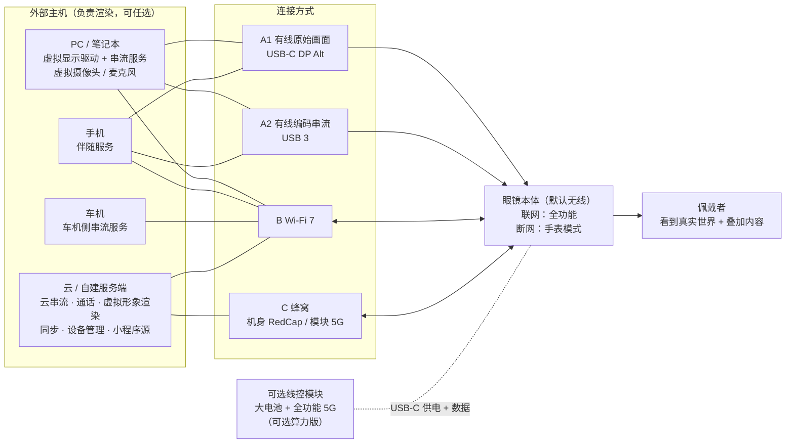
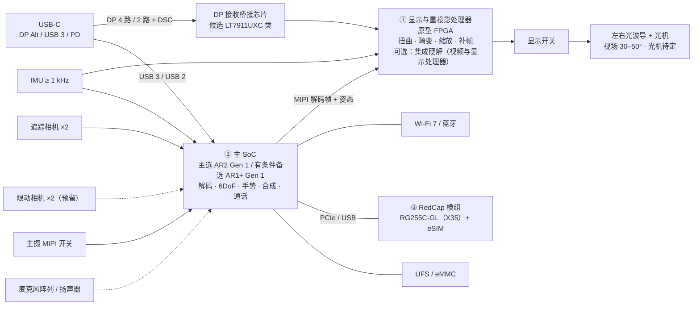
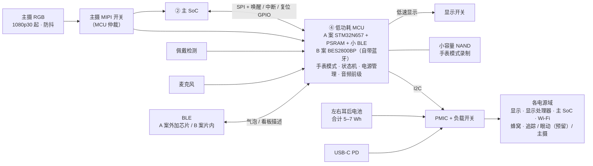
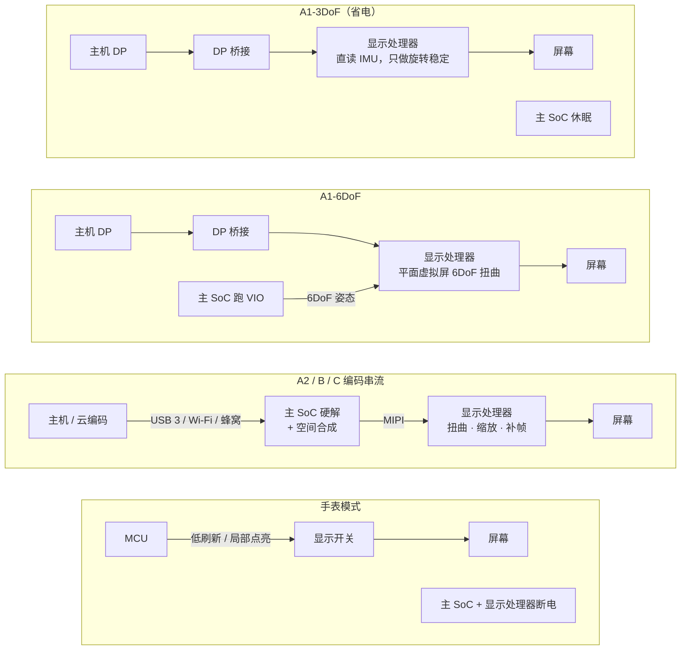
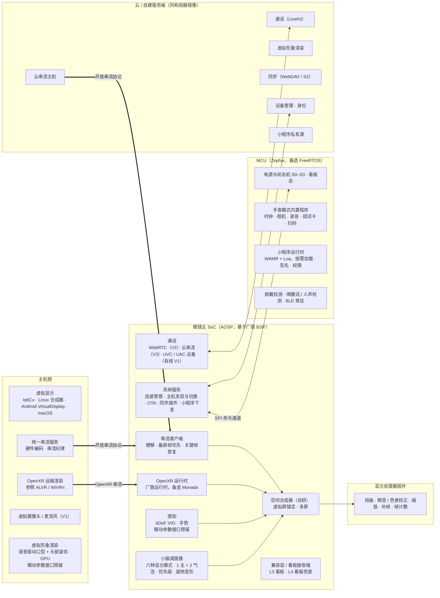
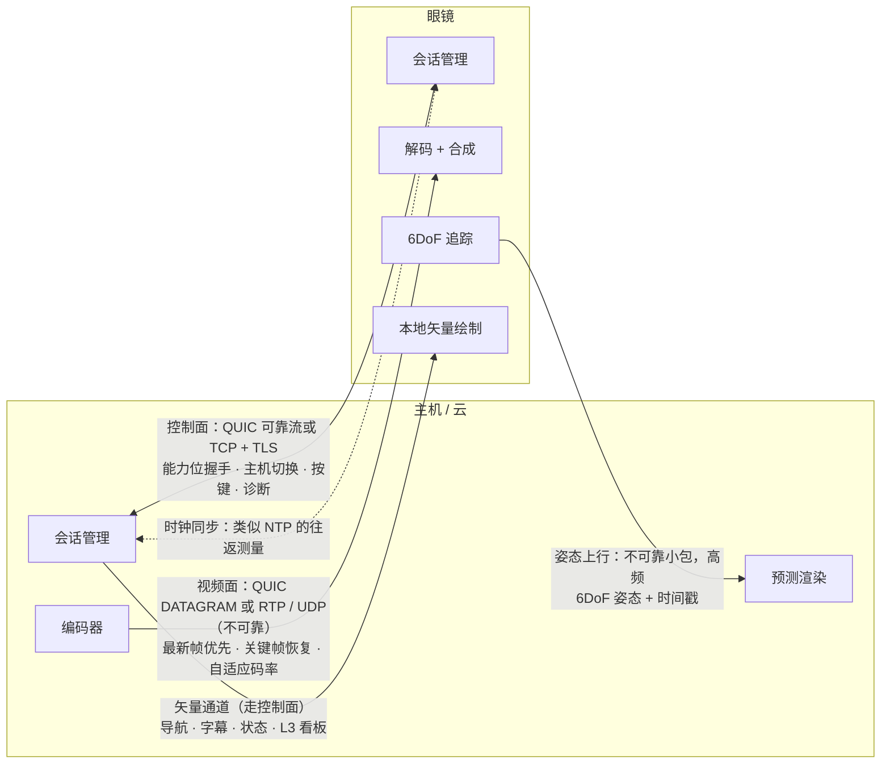
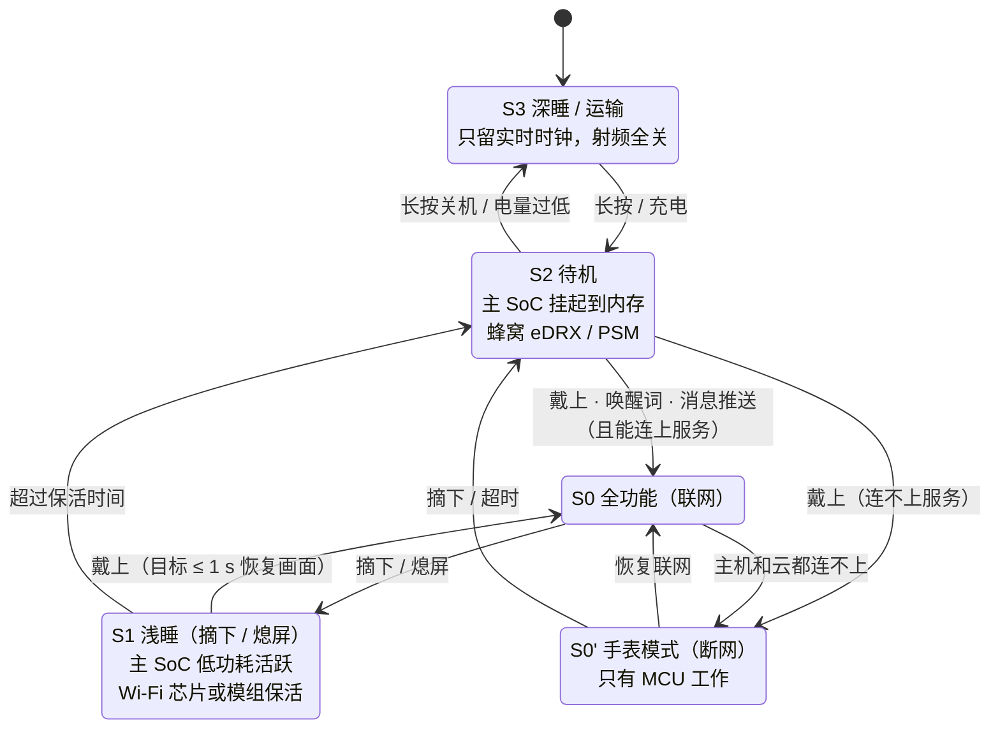
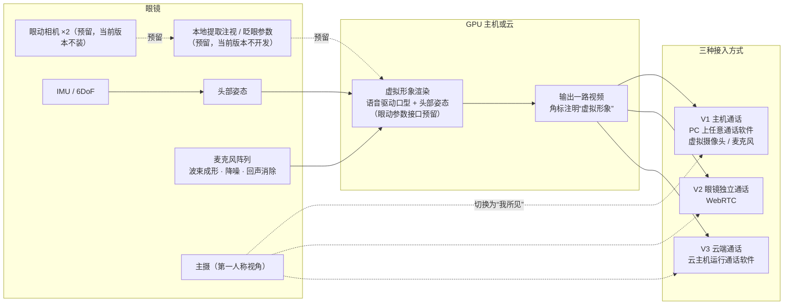
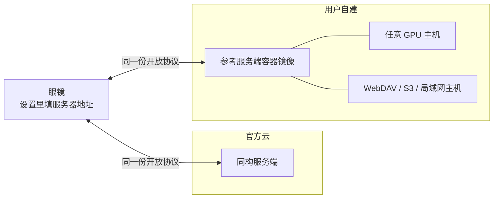

# 系统架构图（初版）

**v0.1.2 · 2026-11-04 · 依据 [串流终端方向](streaming-direction.md) v0.7.5、[技术路线](technical-roadmap.md) v0.1.1 · 配套 [设计开发要求](design-requirements.md)**

本页把方案和技术路线画成图，供评审和分工使用。

> **证据边界**：
> - 图中的芯片和器件型号都是**候选**，按技术路线第 1 节的门禁和切换条件定案，M1 结束前不冻结。
> - 接口和数值是【设计目标】，还没有实测。
> - 图用 Mermaid 编写，GitHub 上能直接显示。
> - **动态版**：同样 9 张图的信号流动动画（Remotion），单文件 HTML 在 [`visuals/architecture-motion/dist/system-architecture-motion.html`](../visuals/architecture-motion/dist/system-architecture-motion.html)，下载后用浏览器打开。

**目录**

1. 系统全景
2. 眼镜硬件框图
3. 显示数据通路
4. 软件栈分层
5. 开放协议的通道
6. 功耗状态机
7. 视频通话与虚拟形象链路
8. 部署视图：官方云与自建

---

## 1 系统全景

眼镜靠网络工作，不依赖手机。联网时，渲染交给 PC、手机、车机、云这四类主机中的任意一台；断网时，眼镜退化为手表级设备。按决定 #22，这四类主机都是**手**，眼镜 + 云端 LLM 是**脑**，眼镜自身算力只当**小脑**；谁的手谁渲染，重渲染不在眼镜上。

**要点**：
- 多台主机同时可用时，按 **有线 > 同一局域网 > 云** 的顺序优先（方案第 3.4 节）。
- 判断“联网”的依据是能不能连上主机或云，而不是有没有连手机（方案第 2.1 节）。

---

## 2 眼镜硬件框图

眼镜里有四颗主芯片：①显示与重投影处理器（可选：集成硬件解码，扩展为视频与显示处理器）、②主 SoC、③RedCap 蜂窝、④低功耗 MCU。决定 #24 的 A 案在 MCU 外再加一颗小 BLE 芯片，框图按“四颗主芯片 + 1 颗小 BLE”表示；B 案 MCU 改用 BES2800BP，蓝牙在片内。见技术路线第 0、1.2、1.5、1.6 节。

### 2.1 显示、计算与连接

### 2.2 低功耗、存储与电源

**布局**（方案第 7.3 节）：前框只放光学、显示、追踪 / 主摄和麦克风；眼动相机仅预留结构空间，当前版本不装。主板、射频、电池全部后移到镜腿，主 SoC 和蜂窝放外侧远离太阳穴，两侧镜腿重量差 ≤ 3 g。

**设计约束**（见技术路线第 1.6–1.9 节、方案第 7.3 节）：

- **主摄共享**：同一时刻只给 MCU 或主 SoC 一方用，由 MCU 仲裁。I2C、时钟、复位、电源随 MIPI 开关一起切换。
- **显示开关**：正常时显示接显示处理器；手表模式下切到 MCU，主 SoC 和显示处理器都断电。
- **存储分开**：主 SoC 挂 UFS / eMMC，MCU 挂 NAND。手表模式录的内容，联网后经 SPI 交给主 SoC 同步。
- **BLE 常驻**：手机这只手的气泡 / 看板描述主要走 BLE，主 SoC 睡眠时由 MCU 收；A 案外加小 BLE 芯片，B 案用 BES2800BP 片内蓝牙（方案第 5.4、6.2 节）。
- **音频前级常驻**：麦克风阵列直连 MCU，唤醒词与人声检测在主 SoC 睡眠时也能工作；扬声器 / 蓝牙耳机做下行与切换（方案第 5.4 节）。

### 2.3 USB-C 各模式的通道分配

| 模式 | 高速通道 | 眼镜的角色 |
| --- | --- | --- |
| A1 有线原始 | 4 路 DP（主机只给 2 路时，用 2 路 DP + DSC） | DP 接收端 + USB 2.0 设备（UVC / UAC）+ 受电 |
| A2 有线编码 | USB 3 | USB 设备（串流 + UVC / UAC）+ 受电 |
| 接线控模块 | USB 3（视模块版本加 DP） | 受电；数据角色由模块决定 |
| 充电 | — | 受电（PD） |

---

## 3 显示数据通路

扭曲始终在离屏幕最近的一级做，所以头动感知延迟不受网络影响（方案第 3.5 节）。

**边界**：
- DP 送来的是二维画面。合成为空间里的平面虚拟屏时，平移重投影是精确的。
- 如果 DP 送来的是 3D 内容，没有深度信息，平移只能近似。这类内容改走 L1 OpenXR 串流。

---

## 4 软件栈分层

**分层对应**（决定 #23）：L0 系统级虚拟显示器 = 投屏（接管），只在用户要求接管时出现；L3 语义转化 = 看板；L4 像素转化 = 看板的兜底。投屏中的付款、密码等安全页在眼镜上黑屏，提示到手机处理。

---

## 5 开放协议的通道

见技术路线第 2.3 节。协议规范和参考实现一起公开，官方云和自建服务端用同一份规范。

**两条规则**：
- 控制面和视频面至少要分开拥塞控制。
- 视频面**不能用 QUIC 的普通流**：普通流可靠有序，会被队头阻塞。

---

## 6 功耗状态机

所有状态都由 MCU 调度（方案第 5.1 节、技术路线第 1.9 节）。

**恢复顺序**：先显示缓存帧，再重连，再等关键帧。超过保活时间就断开重连。

---

## 7 视频通话与虚拟形象链路

**主机与通话方式的对应**（技术路线第 2.2 节）：

| 主机 | 通话主路 |
| --- | --- |
| PC | V1 |
| 手机 | V2 / V3 |
| 车机 | V2 |
| 云 | V3 |

**降级**：没有 GPU 主机或云时，降级为静态头像 + 口型动画。

---

## 8 部署视图：官方云与自建

**原则**：官方云不能成为使用眼镜的前提。离线内容默认不上传，同步目标由用户选择（方案第 2.4、4.4 节）。

---

## 修订记录

| 版本 | 日期 | 内容 |
| --- | --- | --- |
| v0.1 | 2026-11-03 | 初版，共 8 张图：系统全景、硬件框图、数据通路、软件栈、协议通道、功耗状态机、通话链路、部署视图 |
| v0.1.1 | 2026-11-04 | 显示方案改为左右光波导 + 光机；① 增加可选硬解（视频与显示处理器）；对应方案 v0.7.4 |
| v0.1.2 | 2026-11-04 | 同步决定 #22–#24：MCU 改 A/B 两案（A 案外加小 BLE），补 BLE 常驻与音频前级；L0/L3/L4 改为投屏 / 看板 / 看板兜底；对应方案 v0.7.5 |
